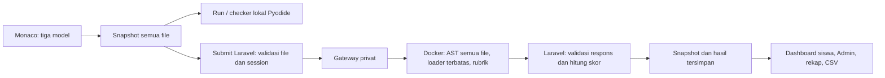

# Implementasi Latihan Coding 2 multi-file

Tanggal: 13 November 2026, WITA. Perubahan dilakukan pada checkout lokal OOPy.

## 1. Kondisi awal

Editor Monaco telah memiliki model per file, explorer/tab, penanda perubahan,
perpindahan dengan keyboard, Ctrl+Enter, Stop, Reset dengan konfirmasi, dan runtime
manager bersama. Runner Pyodide telah menulis proyek ke filesystem virtual,
menjalankan entry point, mengizinkan import proyek, serta membersihkan modul
antarkerja. Materi BAB 4 sudah memakai contoh ekosistem/sungai/rawa multi-file.
BAB 5 mengajarkan overriding, method seragam, serta perubahan perilaku objek.

Latihan Coding 1 dan 2 sebelumnya sama-sama hanya mempunyai main.py kosong.
Latihan 2 lama menguji Ekosistem/Rawa dengan status tetap. Penilaian resmi sudah
memakai gateway privat, Docker, enam inti 15 poin, tambahan output 10 poin,
validasi respons protokol versi 2, dan snapshot JSON dalam kolom code existing.

README, DESIGN, panduan Coding, materi pewarisan/polimorfisme, komponen editor,
worker/runner, request/controller/service Laravel, seeder, agregasi progres,
gateway, sandbox, rubrik, serta tes Coding ditelusuri sebelum perubahan.

## 2. Akar masalah

`SubmitCodingRequest` membatasi files pada satu main.py; controller memeriksa
byte main.py saja. Gateway juga hanya menerima main.py. Validator AST sandbox
menolak seluruh import dan hanya mengompilasi main.py. Checker lama mengambil
Ekosistem/Rawa dari namespace entry file dan belum menguji kepemilikan modul,
tinggi air dinamis, atau pemanfaatan constructor induk yang benar-benar terjadi.
Identitas lama pada seeder dan agregasi progres tidak dapat digunakan kembali
karena akan membuat kelulusan lama berlaku pada kompetensi baru.



Checker lokal tidak menjadi sumber nilai resmi. Submit akun mengirim snapshot
yang sama ke Laravel setelah pemeriksaan lokal selesai, termasuk bila checker
lokal gagal. Eksekusi resmi tetap melalui container; tidak dipindahkan ke PHP
atau proses gateway.

## 3. Rancangan soal dan tujuan belajar

Judul halaman: **Latihan 2 — Implementasi OOP dengan Multi-File Python**, mengikuti
judul yang diminta pengguna. Judul soal: **Membangun Sistem Pemantauan Ekosistem
Rawa Berbasis Multi-File**.

Mahasiswa mempraktikkan pengorganisasian modul, superclass/subclass, constructor,
atribut instance, super(), overriding, import, instansiasi, dan perilaku dinamis.
Instruksi tersusun menurut urutan file berikut; tidak ada solusi/template di editor.

| File | Kompetensi dan ketentuan |
| --- | --- |
| ekosistem.py | Class Ekosistem, constructor menerima nama/lokasi dan menyimpannya per instance; status() mengembalikan Belum dipantau |
| rawa.py | Impor induk; class Rawa(Ekosistem); constructor menerima tambahan tinggi_air_cm dan memakai super(); status() mengembalikan Siaga untuk >= 80, selain itu Normal |
| main.py | Impor Rawa, buat objek Rawa Bangkau / Hulu Sungai Selatan / 85, cetak nama-lokasi serta hasil status melalui objek |

Ambang 80 cm dinyatakan sebagai aturan simulasi pemrograman, bukan standar
peringatan banjir. Contoh output memiliki dua baris:

```text
Rawa Bangkau - Hulu Sungai Selatan
Status air: Siaga
```

## 4. Implementasi file dan komponen

Ketiga source awal bernilai string kosong. Monaco, tab, explorer, model, entry
main.py, dan mekanisme snapshot digunakan kembali. Tidak ada fitur membuat atau
menghapus file bebas. Penjagaan file kosong kini menunjukkan file mana yang belum
diisi pada proyek multi-file; pengecekan satu main.py Latihan 1 dipertahankan.

Run memakai file terbaru, termasuk model yang tidak sedang aktif. Kesalahan
import/sintaks menyebut file pada traceback. Isi model tetap setelah eksekusi,
error, Stop, dan Submit. Reset batal mempertahankan seluruh source; Reset yang
dikonfirmasi mengosongkan semua model. Shortcut/navigasi tab dan penanda perubahan
tetap memakai implementasi existing.

Runner menambahkan metadata modul dan observasi pemanggilan contoh untuk checker.
Observasi dibatasi 1.000 kejadian dan profiler sebelumnya selalu dipulihkan.
Metadata ini dipakai untuk memberi bonus output hanya bila program benar-benar
membuat objek dan memanggil status di main.py, termasuk bila dibungkus fungsi
main(). Mencetak dua string hardcoded tanpa objek tidak mendapat bonus.

Desain mengikuti DESIGN.md: ruang praktikum Python, mint–teal, Plus Jakarta Sans,
ENERGY 2 / RHYTHM 2 / MOTION 1. Instruksi berurutan dipertahankan sebelum editor;
tidak ada perubahan palet, CSS, library UI, atau dekorasi baru.

## 5. Validasi, rubrik, dan keamanan grader

### Kontrak request dan penyimpanan

Latihan 1 menerima tepat main.py. Latihan 2 menerima tepat ekosistem.py, rawa.py,
main.py. Masing-masing wajib string berisi kode; file hilang, ekstra, nama lain,
path traversal, path absolut, array numerik, source bukan string, dan whitespace
ditolak. Per file dan total proyek dibatasi 30.000 karakter / 60.000 byte UTF-8.
Agregat tersebut menjaga request JSON di bawah batas 200.000 byte gateway,
termasuk source yang diangkut dengan Unicode escaped.

Request hanya menerima field files. Identitas dan nilai dari browser ditolak;
akun diambil dari session. Middleware existing mempertahankan files.* tanpa
trim. Tes memeriksa source dengan baris kosong awal/akhir tetap identik pada
HTTP grader dan database. Snapshot tetap berupa JSON entry_file dan files pada
exercise_submissions.code. Tidak ada kolom atau migration baru.

### Rubrik

| Urutan / ID | Kompetensi | Poin | Wajib |
| --- | --- | --- | --- |
| 1 modules | Class berada pada modulnya, import berfungsi, method tidak dipindahkan ke main | 15 | Ya |
| 2 constructor | Constructor Ekosistem dan atribut sesuai parameter pada beberapa objek | 15 | Ya |
| 3 parent_status | Status dasar Belum dipantau | 15 | Ya |
| 4 inheritance | Rawa benar-benar subclass Ekosistem | 15 | Ya |
| 5 child_constructor | Atribut induk/tinggi air dan pemanggilan super initializer nyata | 15 | Ya |
| 6 overriding | Implementasi status sendiri, batas 80, perubahan atribut, objek independen | 15 | Ya |
| 7 presentation | Contoh objek, pemanggilan method, dan output main.py | 10 | Tidak |

Seluruh inti harus berhasil: minimal 90 poin. Output bersifat tambahan. Laravel
tetap memeriksa versi, key, ID lengkap dan urut, required, weight, tipe data,
serta status laporan sebelum menghitung nilai sendiri. Protokol tetap versi 2;
key exercise baru membedakan rubrik baru dari paket lama. Respons lama, hilang,
duplikat, berubah urutan/bobot, atau tidak lengkap menghasilkan 503 tanpa
submission tersimpan. Rubrik Latihan 1 tetap sama.

Perilaku diperiksa dengan instansiasi dan pemanggilan method, bukan substring
source. Super diamati dengan probe tepercaya lalu namespace dipulihkan. Pemanggilan
Ekosistem.__init__ secara langsung, komentar super(), atau super di cabang yang
tidak dijalankan tidak memenuhi kompetensi tersebut. Bentuk super(Rawa, self),
import modul/alias biasa, variasi percabangan, dan main() didukung.

Uji mencakup 79.9, 80, 80.0, 85, 0, 12.5, 180, nilai acak privat di bawah/di atas
batas, nama/lokasi acak, pembaruan tinggi, dan dua objek independen. Nilai yang
di-hardcode untuk 85 atau hasil status yang dihitung sekali di constructor gagal.
Kapitalisasi/whitespace status serta output yang setara tetap diterima.

### Import terbatas dan isolasi

Semua file diparse dan divalidasi AST sebelum file mana pun dieksekusi. Pada key
baru saja, loader membuat modul dalam memori dari source yang sudah divalidasi.
Tidak memakai importlib, sys.path, file host, atau pencarian modul umum untuk
memuat source mahasiswa pada grader resmi.

| Pemanggil | Modul yang boleh diimpor |
| --- | --- |
| main.py | ekosistem, rawa |
| rawa.py | ekosistem |
| ekosistem.py | Tidak ada |
| Latihan 1 / versi lama | Tidak ada kemampuan import baru |

Export from-import hanya Ekosistem dan Rawa sesuai modul. Relative/wildcard/
submodule/import sistem, alias internal/builtins, decorator, introspeksi, dan
metaclass ditolak. Builtins terbatas tidak menyediakan open, eval, exec, globals,
akses jaringan, atau subprocess kepada source pengguna. Nama __import__ tidak
dapat dipanggil langsung oleh source; hanya bytecode import tervalidasi yang
memakai loader internal. Variabel pengguna bernama results, score, passed,
run_checks, type, atau vars tidak mengganti fungsi/rubrik tepercaya.
Pemeriksaan AST juga membatasi atribut pada class pattern serta binding mapping
pattern agar sintaks match tidak dipakai untuk mengakses atribut interpreter
atau menimpa builtins melalui jalur yang tidak memakai ast.Attribute/ast.Name.

Pembatasan container dipertahankan: network none, read-only, non-root,
cap-drop ALL, no-new-privileges, CPU 0,5, CPU time 3 detik, RAM/swap 128 MB,
16 PID, tmpfs 8 MB, wall timeout 8 detik, serta cleanup container. Tidak ada host
mount atau Docker socket dalam container. AST/builtins bukan pengganti batas
Docker. Keamanan adversarial penuh tidak dinyatakan terbukti hanya dari unit test.

Pyodide tetap runner umum dalam browser. Run bukan penilaian resmi dan bukan
salinan batas sandbox Docker; parity diuji untuk solusi/perilaku dalam kontrak.
Tidak ada source mahasiswa dieksekusi pada Laravel/gateway. Unit test Python
hanya menjalankan fixture tetap buatan pengembang yang tercatat dalam repository.

## 6. Kompatibilitas riwayat

Versi baru menggunakan **coding-latihan-2-multifile-v1**. URL tetap
/coding/latihan-2. Seeder idempoten membuat/memperbarui identitas aktif tersebut
dan tidak menyentuh record coding-latihan-2 lama. Nilai, source JSON, output,
timestamp, dan submission lama tidak dihapus atau ditimpa.

Agregasi progres, skor terbaik, rekap/filter Admin, dan CSV memakai identitas
aktif. Kelulusan lama memberi 0% pada versi baru sampai ada kelulusan baru.
Riwayat lama tetap tampil pada aktivitas/detail Admin dengan label versi lama.
Tes memverifikasi reseed, ID aktif stabil, atribut record lama identik, riwayat
tetap tersedia, serta skor 90 versi baru menghasilkan progres 50% jika hanya
Latihan 2 yang selesai.

Tidak ada seeder yang dijalankan pada database utama selama pekerjaan ini.
Seeding dan pengujian penyimpanan memakai database SQLite baru/memory yang
terisolasi. Tidak ada perubahan .env, kredensial, autentikasi, atau OAuth.

## 7. Daftar file berubah

| Bagian | File |
| --- | --- |
| Soal dan petunjuk | resources/coding/exercises.php; resources/views/coding/show.blade.php |
| Request dan penyimpanan | app/Http/Requests/Coding/SubmitCodingRequest.php; app/Http/Controllers/CodingController.php |
| Versi progres/riwayat | app/Services/CodingProgressService.php |
| Editor/runner bersama | public/js/live-code/live-code-instance.js; public/js/live-code/project-runner.py |
| Grader | services/coding-grader/checks.py; sandbox.py; server.py |
| PHP QA | tests/Feature/CodingTest.php; CodingMultifileTest.php; DashboardTest.php; Admin/CodingReportsTest.php |
| Fixture dan QA lokal | tests/Fixtures/coding-multifile.json; tests/browser/coding-fixtures.mjs; tests/js/coding-checkers.test.js; checker-harness.py |
| Browser dan fixture DB | tests/browser/coding.mjs; coding-grader.mjs; admin-coding.mjs; admin-sandbox.php; dashboard-coding-fixture.php |
| Python QA | services/coding-grader/test_grader.py |
| Dokumentasi | docs/coding.md; docs/README.md; laporan ini; docs/evidence/coding-multifile-2026-11-13/ |

CodingExerciseSeeder, LiveCode Blade, python-worker.js, runtime manager, schema,
serta dependency tidak perlu diubah karena kontraknya sudah mendukung reuse ini.

## 8. Hasil pengujian

| Pengujian | Hasil aktual |
| --- | --- |
| php artisan test --compact | PASS, 257 tes / 5.252 assertion; [log](evidence/coding-multifile-2026-11-13/php-tests.txt) |
| node --test tests/js/*.test.js | PASS, 24 tes; [log](evidence/coding-multifile-2026-11-13/javascript-tests.txt) |
| python -m unittest discover -s services/coding-grader -p test_grader.py -v | PASS, 21 tes lulus, 3 integrasi Docker dilewati; [log](evidence/coding-multifile-2026-11-13/python-tests.txt) |
| node tests/browser/coding.mjs --auth | PASS Monaco/Pyodide nyata, kedua latihan, tamu, UI akun, guard kosong, import/error, source, tab/keyboard, Stop, Reset, Ctrl+Enter, lima viewport; [log](evidence/coding-multifile-2026-11-13/browser-tests.txt) |
| node tests/browser/live-code.mjs | PASS editor umum, custom entry/package/import, isolasi, antrean/timeout, BAB 4–6, checker/solusi alternatif, Reset, keyboard, runtime retry; [log](evidence/coding-multifile-2026-11-13/live-code-browser-tests.txt) |
| npm.cmd run build | PASS, Vite 58 modul; npm.cmd dipakai karena npm.ps1 diblokir kebijakan PowerShell |
| Pint dan git diff --check | Dijalankan pada file PHP yang berubah serta diff final |
| Docker nyata | BELUM DIJALANKAN: Docker CLI tersedia, tetapi Engine/named pipe Linux tidak tersedia, termasuk setelah pemeriksaan di luar sandbox |

Browser memakai Edge headless dan server PHP pada SQLite baru di port pengujian
terpisah. CDN Monaco/Pyodide sempat ditolak ERR_NETWORK_ACCESS_DENIED di sandbox;
tes dijalankan ulang dengan izin jaringan dan berhasil. Bootstrap/font memakai
cache QA lokal. Screenshot Coding pada 390/1440 ada di
storage/framework/testing/coding-multifile-browser/. Overflow diperiksa pada
320/390/768/1024/1440 px. Ini bukan audit semua browser atau screen reader.

Penyimpanan hasil dan konsistensi dashboard/Admin diuji dengan Http::fake di
Laravel. Browser akun memakai grader tidak tersedia (503), respons UI terkontrol,
dan acknowledgement tertunda untuk memastikan tidak ada progres sebelum konfirmasi.
Hasil ini tidak dinyatakan sebagai bukti grading Docker nyata. Suite Docker dan
browser integrasi Docker sudah diperbarui untuk kontrak baru, tetapi belum
dijalankan karena Engine tidak aktif.

## 9. Regresi dan pemeriksaan desain

Tes Latihan 1 tetap memeriksa pH inklusif, object independen, perubahan atribut,
90/100 poin, snapshot, otorisasi, CSRF, rate limit, respons rusak, serta retry.
Tes Python mempertahankan kasus grader single-file lama. Suite JavaScript
memeriksa checker pewarisan/polimorfisme/ABC dan runtime manager. Suite PHP
mencakup autentikasi, materi, kuis, Evaluasi Akhir, Dashboard, Admin, dan CSV.

Delivery Gate pada permukaan yang diubah:

- Hard Gate PASS: kedua halaman Coding dijalankan di browser; tab/fokus,
  shortcut, blank/error, Reset/Stop, serta overflow lima viewport diperiksa.
  Tidak ada aset visual, statistik, testimoni, atau navigasi baru.
- Purpose Gate PASS: tiga file menyatakan tanggung jawab program, instruksi
  mengikuti urutan pengerjaan, dan feedback menyebut file yang belum lengkap.
  Komponen/palet/typography existing dipertahankan untuk konsistensi ruang belajar.
- Liveliness PASS: ENERGY 2 / RHYTHM 2 / MOTION 1 mengikuti DESIGN.md. Soal,
  editor, output, dan hasil memiliki hierarki yang sama; aksen mint–teal dan
  motif praktikum Python tetap digunakan.
- Craftsmanship PASS: Run/Pyodide, checker, model, tab, keyboard, Reset/Stop,
  serta kontrak server diperiksa. Batas verifikasi Docker dan browser produksi
  dinyatakan terbuka pada bagian 8 dan 10.

## 10. Risiko dan aktivasi manual

1. Aktifkan Docker Linux Engine, lalu rebuild image dari source terbaru:

   ```powershell
   docker info --format '{{.OSType}}'
   docker build -t oopy-coding-sandbox:1 services/coding-grader
   ```

2. Mulai ulang gateway menggunakan konfigurasi privat existing. Tidak perlu
   mengganti token atau .env jika sudah benar. Gateway dan image harus diperbarui
   bersama; deployment image/gateway lama menolak key baru dan tidak boleh
   menghasilkan kelulusan.
3. Backup dan tinjau database tujuan. Jalankan seeder **secara manual** setelah
   komponen grader siap:

   ```powershell
   php artisan db:seed --class=CodingExerciseSeeder --force
   ```

4. Gunakan database QA terpisah untuk integrasi nyata:

   ```powershell
   $env:OOPY_TEST_DOCKER = '1'
   python -m unittest discover -s services/coding-grader -p test_grader.py -v
   ```

   Ikuti isolasi MariaDB dan gateway pada docs/coding.md untuk menjalankan
   tests/browser/coding-grader.mjs. Jangan memakai source pengguna di host
   sebagai pengganti container atau menunjuk suite penulisan ke database utama.
5. Verifikasi akun yang hanya lulus versi lama belum selesai pada versi baru;
   periksa snapshot tiga file, nilai, dashboard, rekap Admin, dan CSV setelah
   submission Docker yang benar. Latihan 1 harus tetap dapat diselesaikan.

Belum dilakukan: integrasi Docker nyata, penulisan ke database utama, uji beban,
browser selain Edge, dan audit screen reader menyeluruh. Tidak ada migration,
reset/hapus database, commit, push, merge, atau PR.
