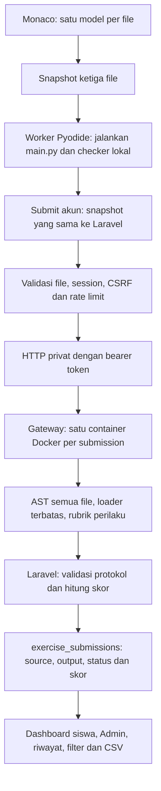

# Audit integrasi Latihan Coding 2 multi-file

Tanggal: 13 November 2026, WITA. Checkout awal: `7499ed4684d2cfe98e66cf12af547bb246d03b91`.

Status akhir: **PASS WITH LIMITATIONS**. Seluruh pengujian yang dijalankan setelah perbaikan lulus. Integrasi Docker nyata belum dapat dijalankan karena Linux Engine tidak tersedia. Hasil mock gateway, fixture database, dan checker Pyodide tidak menggantikan bukti grading container.

## A. Ringkasan dan cakupan

Sebelum audit, Latihan 2 sudah menyediakan `ekosistem.py`, `rawa.py`, dan `main.py`, memakai identitas aktif `coding-latihan-2-multifile-v1`, serta menyimpan snapshot JSON melalui penilaian server. Working tree awal bersih. Implementasi ini melanjutkan arsitektur yang dijelaskan dalam README, DESIGN, `docs/coding.md`, dan `docs/coding-multifile-2026-11-13.md`.

Audit membaca katalog soal, Blade Coding/komponen editor, model Monaco, runtime manager, worker, runner Pyodide, request/controller Laravel, service grader, model submission, seeder, agregasi progres, Dashboard, laporan Admin/CSV, gateway, sandbox, rubrik bersama, dan pengujian terkait. Empat bug aplikasi/penilaian diperbaiki, disertai dua koreksi harness browser yang sudah tidak sesuai implementasi aktual.

Tidak ada perubahan `.env`, kredensial, OAuth, autentikasi, role, schema, dependency, materi, atau isi soal. Database utama tidak digunakan untuk fixture atau migration. Tidak ada commit, push, merge, atau deployment.

## B. Alur dan hasil pemeriksaan

### Editor dan Pyodide

- Ketiga model dapat diedit terpisah. Snapshot mengambil seluruh model, termasuk file tidak aktif; entry point tetap `main.py`.
- Browser nyata memeriksa perpindahan tab, navigasi keyboard, Ctrl+Enter, penanda perubahan, Run, Submit, Stop, Reset batal/konfirmasi, serta source yang tetap utuh setelah error.
- Regresi tambahan mengubah `rawa.py` yang tidak aktif dari keluaran `VERSI A` ke `VERSI B` dengan panjang source sama. Eksekusi kedua memakai versi terbaru dan tidak menampilkan output lama.
- SyntaxError dan import error menunjuk `rawa.py`. Source file lain tetap utuh. Reset terkonfirmasi mengosongkan ketiga file dan Run berikutnya tidak mengembalikan kode awal.
- Runtime manager mengunci interaksi saat berjalan/menyimpan, menolak Submit ganda, mengantrekan pekerjaan antar-editor, serta memulai ulang worker setelah Stop/timeout. Suite editor umum memeriksa antrean, pembatalan, recovery, pembatasan output, dan isolasi modul.
- Coding diperiksa pada 320/390/768/1024/1440 px. Screenshot desktop dan mobile ditinjau dari `storage/framework/testing/multifile-integration-audit/latihan-2-{390,1440}.png`.

### Soal dan rubrik

Kontrak soal konsisten: `Ekosistem` menyimpan nama/lokasi dan mengembalikan `Belum dipantau`; `Rawa` mewarisi superclass, memakai initializer induk melalui `super()`, menyimpan tinggi air, dan mengembalikan `Siaga` untuk tinggi >= 80. Status mengikuti atribut terbaru. Ambang ini merupakan aturan simulasi latihan.

| Urutan | ID | Poin | Wajib |
| --- | --- | --- | --- |
| 1 | modules | 15 | Ya |
| 2 | constructor | 15 | Ya |
| 3 | parent_status | 15 | Ya |
| 4 | inheritance | 15 | Ya |
| 5 | child_constructor | 15 | Ya |
| 6 | overriding | 15 | Ya |
| 7 | presentation | 10 | Tidak |

Semua inti wajib berhasil, sehingga kelulusan bernilai 90 atau 100. Satu inti gagal dengan pemeriksaan lain berhasil menghasilkan 85 dan tidak lulus. Bobot/ID/urutan/required tidak ditentukan frontend. Laravel menolak respons grader yang tidak sesuai dan menghitung skor dari hasil pemeriksaan yang telah divalidasi.

Rubrik menguji object, atribut, relasi class, method, dan perilaku setelah mutasi, tanpa pencarian substring source untuk menentukan kompetensi. Pemeriksaan output memakai keluaran program dan observasi pembuatan/pemanggilan object; mencetak contoh hardcoded saja tidak memperoleh kelulusan.

Kasus benar mencakup import modul, from-import dengan alias, `super()` biasa/eksplisit, argumen keyword initializer, assignment tuple, fungsi `main()` dan guard `__name__`. Kasus salah mencakup constructor/atribut salah, superclass salah, tanpa inheritance/override, pemanggilan initializer langsung, status hardcoded, batas `> 80`, status yang disimpan hanya saat constructor, file kosong/hilang, syntax/import error, serta hasil checker palsu. Batas 79.9/80/80.0/85, object berbeda, pembaruan atribut, dan sampel acak server tetap diperiksa.

Dua celah probe `super()` ditemukan dan diperbaiki pada bagian C. Uji parity memakai fixture tetap untuk membandingkan ID, hasil, bobot, dan required antara checker lokal dan grader Python. Browser Pyodide nyata juga memeriksa kedua fixture celah dan menghasilkan skor lokal 85.

### Laravel dan penyimpanan

- Request hanya menerima `files`, dengan tepat tiga nama file untuk Latihan 2. Identitas akun berasal dari session dan identitas latihan dari route/katalog server.
- Source wajib string berisi kode. Per file dan total proyek dibatasi 30.000 karakter/60.000 byte UTF-8. Field tambahan, path traversal/absolut, struktur numerik/nested, file tambahan/hilang, serta source whitespace ditolak.
- Pengecualian TrimStrings mempertahankan source. Tes membandingkan source seluruh file secara persis pada request grader dan snapshot database.
- Snapshot disimpan pada `exercise_submissions.code` sebagai JSON `entry_file` dan `files`, bersama output/status/skor/waktu resmi dan pemilik session. Percobaan valid berikutnya merupakan baris baru.
- Respons gateway gagal, timeout koneksi, format rusak, rubrik lama/duplikat/hilang/berubah, atau konfigurasi tidak tersedia menghasilkan 503 tanpa submission sukses palsu. Runtime error sandbox yang sah menghasilkan status error dengan skor 0.
- Autentikasi, CSRF, pembatasan enam Submit per menit, pemalsuan identitas/nilai, dan isolasi akun tercakup dalam tes Laravel. Browser mengirim seluruh source ke Laravel dan membuktikan gateway tidak tersedia tidak menambah progres.
- UI menunggu konfirmasi server sebelum menampilkan nilai resmi/progres tersimpan. Respons UI tertunda, error HTTP/jaringan, dan percobaan gagal juga diperiksa melalui simulasi jaringan yang dinyatakan sebagai simulasi.

### Gateway, sandbox, dan keamanan

Gateway hanya menjalankan Docker CLI, bukan source Python pengguna pada proses host. Pemeriksaan kode mempertahankan container tanpa jaringan, read-only, non-root, cap-drop ALL, no-new-privileges, batas CPU/RAM/PID/tmpfs, wall timeout, dan cleanup pada `finally`.

Semua file divalidasi AST sebelum eksekusi. Loader resmi hanya memuat dependensi proyek yang diizinkan. Import sistem, relative/wildcard/submodule, alias internal/builtins, akses atribut interpreter, decorator/metaclass, serta pola introspeksi dilarang. Builtins terbatas tidak menyediakan open/eval/exec/compile/globals/locals/getattr/setattr kepada source pengguna. Python unit test hanya menjalankan fixture tetap buatan pengembang; payload introspeksi tambahan diperiksa melalui AST tanpa dieksekusi.

Tes HTTP gateway dengan Docker mock menolak manipulasi score/passed/results, struktur file salah, path traversal, source terlalu besar, dan Unicode surrogate tidak valid. Request sah berikutnya tetap diproses. Tes unit memeriksa flag container, timeout dan pemanggilan cleanup dengan mock subprocess.

Uji konsumsi memori dan infinite loop multi-file ditambahkan sebagai integrasi opt-in Docker. Payload ini tidak dijalankan pada host. Hasil nyata resource limit, cleanup container, image, dan recovery gateway masih tertunda. AST/builtins terbatas merupakan pertahanan tambahan, sedangkan batas keamanan eksekusi resmi tetap container. Pyodide adalah runner latihan umum dalam browser dan memiliki kontrak keamanan yang berbeda.

### Dashboard, Admin, dan riwayat

`CodingProgressService` dan laporan Admin membatasi agregat pada key aktif. Key lama `coding-latihan-2` hanya ikut riwayat dengan label versi lama. Seeder meng-upsert versi aktif tanpa menghapus latihan/submission lama; tes membandingkan atribut record lama sebelum dan sesudah reseed.

Tes memeriksa skor terbaik, jumlah percobaan, progres 0/50/100%, kegagalan setelah pernah lulus, status belum mulai/belum lulus/selesai, isolasi akun, serta kesesuaian ringkasan siswa dan Admin. Label pada daftar/detail Coding kini juga membedakan sudah mencoba tetapi belum lulus.

Browser Admin memakai fixture SQLite, memeriksa detail siswa, riwayat berhalaman, filter Coding dan kuis gabungan, pencarian literal, sortir, export CSV yang benar-benar diunduh, nilai nol, BOM, perlindungan formula CSV, dan penolakan akses role biasa/tamu. Browser Dashboard memeriksa riwayat lima terbaru, waktu WITA, nilai 0, login ulang, privasi, tautan latihan, serta progres dari fixture tersimpan. Nilai fixture tersebut tidak diklaim sebagai hasil Docker.

## C. Temuan dan perbaikan

### F1. Tinggi: pemanggilan super bersyarat dapat lulus palsu

- Lokasi: `services/coding-grader/checks.py`, `uses_parent_initializer` dan `child_constructor`.
- Reproduksi: pakai fixture tiga file benar, tetapi panggil `super().__init__` hanya ketika tinggi air == 81.25; pada nilai lain simpan nama/lokasi secara manual.
- Penyebab: probe lama hanya membuat satu object pada nilai tetap 81.25, terpisah dari sampel pemeriksaan atribut.
- Dampak: kompetensi constructor subclass dianggap terpenuhi meskipun initializer induk dilewati pada data biasa.
- Solusi: probe memeriksa setiap kasus constructor, mereset observasi setiap instansiasi, dan menyertakan batas 80 serta sampel privat server. Namespace tetap dipulihkan dalam `finally`.
- Status: diperbaiki. Regresi awal gagal karena `child_constructor` bernilai true; setelah perbaikan fixture mendapat 85 dan tidak lulus. Python parity dan Pyodide nyata memverifikasinya.

### F2. Tinggi: initializer object dianggap initializer Ekosistem

- Lokasi: `services/coding-grader/checks.py`, `SuperProbe.initialize`.
- Reproduksi: isi nama/lokasi secara manual dan panggil `super(Ekosistem, self).__init__()`. Pemanggilan ini melewati `Ekosistem.__init__`.
- Penyebab: probe mencatat setiap pemanggilan method bernama `__init__` melalui super, tanpa memeriksa fungsi yang dituju.
- Dampak: penggunaan super yang tidak meneruskan constructor ke superclass sesuai soal mendapat kelulusan palsu.
- Solusi: cocokkan identitas fungsi method yang benar-benar dipanggil dengan initializer `Ekosistem`, kemudian periksa object dan atribut hasilnya.
- Status: diperbaiki. Tes baru gagal sebelum koreksi, kemudian lulus dengan hasil grading 85. Solusi sah dengan super biasa, eksplisit, dan keyword tetap mendapat 100.

### F3. Sedang: status Coding tidak sesuai submission tersimpan

- Lokasi: `CodingController.php`, kedua Blade Coding, dan `live-code-instance.js`.
- Reproduksi: kirim submission Latihan 2 yang valid tetapi satu kompetensi gagal; buka `/coding`, `/coding/latihan-2`, dan Dashboard.
- Penyebab: halaman Coding hanya membaca boolean pernah lulus; semua kondisi lainnya diberi label Belum Dikerjakan. UI juga hanya memperbarui badge setelah lulus.
- Dampak: siswa yang sudah memiliki percobaan gagal memperoleh status berbeda pada halaman latihan dan Dashboard.
- Solusi: baca keberadaan percobaan milik akun untuk versi aktif, tampilkan Belum Lulus, gunakan aksi Lanjutkan Latihan, dan perbarui badge setelah respons resmi gagal/error.
- Status: diperbaiki. Regresi PHP gagal sebelum perubahan; sesudahnya menguji status halaman, Dashboard, skor 85, serta akun lain yang tetap belum mulai. Browser memeriksa pembaruan badge tanpa reload melalui respons terkontrol.

### F4. Rendah: feedback 422 masih meminta satu main.py

- Lokasi: `public/js/live-code/live-code-instance.js`, `submitOfficial`.
- Reproduksi: terima HTTP 422 saat Submit proyek tiga file.
- Penyebab: pesan validasi masih memakai teks khusus latihan satu file.
- Dampak: pengguna Latihan 2 mendapat petunjuk yang bertentangan dengan soal.
- Solusi: susun pesan dari daftar file latihan aktif dan nyatakan batas total proyek dengan satuan byte UTF-8.
- Status: diperbaiki dan diperiksa browser untuk Latihan 1/2, termasuk source tiga file yang tetap utuh.

### T1/T2. Harness browser tertinggal dari aplikasi

`dashboard-coding.mjs` masih mencari atribut `data-dashboard-coding="coding-latihan-2"`. Implementasi dan fixture sudah memakai key multi-file. Tes awal berhenti saat mencari tautan Latihan 2; helper kini mengambil key dari `codingKeys` bersama.

`admin-coding.mjs` mencari metrik `none_passed` sebagai elemen tersendiri dan status raw `error`. Markup aktual menyajikan jumlah belum lulus sebagai paragraf dan status `Error`. Tes kini memeriksa angka/paragraf serta label yang benar, dan menyertakan badge aktual dalam pemeriksaan kontras. Perhitungan/filter/CSV aplikasi tidak diubah untuk meloloskan tes. Kedua suite lulus setelah koreksi harness.

## D. Pengujian dan bukti

Environment: Windows/PowerShell, PHP 8.2.12, Python 3.14.7, Node 24.19.0, Docker CLI 29.5.2, dan Edge headless melalui Playwright yang sudah tersedia. Xdebug dinonaktifkan hanya pada environment proses pengujian akhir untuk menghindari penantian debugger; konfigurasi PHP dan `.env` tidak diubah.

| Perintah/pemeriksaan | Hasil setelah perbaikan | Bukti |
| --- | --- | --- |
| `php artisan test --compact` | 258 lulus, 5.269 assertion; 0 gagal/skip | [PHP](evidence/coding-multifile-integration-audit/php-tests.txt) |
| `node --test tests/js/*.test.js` | 24 lulus; 0 gagal/skip | [JavaScript](evidence/coding-multifile-integration-audit/javascript-tests.txt) |
| `python -m unittest discover -s services/coding-grader -p test_grader.py -v` | 31 total: 27 lulus, 4 integrasi Docker dilewati, 0 gagal | [Python](evidence/coding-multifile-integration-audit/python-tests.txt) |
| `node tests/browser/coding.mjs --auth` | 1 suite lulus, kedua latihan, lima kelompok hasil | [Coding](evidence/coding-multifile-integration-audit/browser-coding.txt) |
| `node tests/browser/live-code.mjs` | 1 suite lulus, editor umum dan materi BAB 4–6 | [Live Coding](evidence/coding-multifile-integration-audit/browser-live-code.txt) |
| `node tests/browser/dashboard-coding.mjs` | 1 suite lulus, status/progres/riwayat dan privasi | [Dashboard log](evidence/coding-multifile-integration-audit/browser-dashboard.txt), [hasil terstruktur](evidence/coding-multifile-integration-audit/dashboard-results.json) |
| `node tests/browser/admin-coding.mjs` | 1 suite lulus, Admin/filter/CSV/otorisasi | [Admin log](evidence/coding-multifile-integration-audit/browser-admin.txt), [hasil terstruktur](evidence/coding-multifile-integration-audit/admin-results.json) |
| `npm.cmd run build` | Lulus, 58 modul; `.cmd` dipakai untuk PowerShell | [Build dan validasi](evidence/coding-multifile-integration-audit/build-and-validation.txt) |
| `composer validate` | Lulus | [Validasi](evidence/coding-multifile-integration-audit/build-and-validation.txt) |
| `vendor/bin/pint --test app/Http/Controllers/CodingController.php tests/Feature/CodingMultifileTest.php` | Lulus | [Pint](evidence/coding-multifile-integration-audit/build-and-validation.txt) |
| `php artisan route:list --path=coding --except-vendor -v` | Tiga route; POST memakai web/auth/throttle:6,1 | Pembacaan route aktual; tidak ada route berubah |
| `git diff --check` | Lulus | Pemeriksaan diff akhir |
| `docker info --format '{{.OSType}}'` | Gagal: Linux Engine/named pipe tidak tersedia, termasuk di luar sandbox | `dockerDesktopLinuxEngine: The system cannot find the file specified` |
| Docker build, gateway+container nyata, `OOPY_TEST_DOCKER=1`, `coding-grader.mjs` | Tidak dijalankan | Prasyarat Linux Engine tidak tersedia |

Baseline sebelum perubahan: PHP 257 lulus/5.252 assertion; JavaScript 24 lulus; Python 21 lulus/3 skip. Regresi baru sengaja dijalankan sebelum perbaikan F1/F2/F3 untuk membuktikan kegagalannya. Cuplikan output terdapat pada [regresi sebelum perbaikan](evidence/coding-multifile-integration-audit/regression-before-fix.txt).

Percobaan browser pertama di sandbox berhenti menunggu runtime 120 detik. Uji ulang di luar sandbox dengan akses CDN berhasil. Satu percobaan pengembangan harness Coding juga gagal karena assertion baru mengakses Promise sebelum `await`; assertion dikoreksi dan suite final lulus. Kegagalan selector Dashboard/Admin dijelaskan pada T1/T2. Hasil awal ini tidak dihitung sebagai hasil akhir lulus.

PHP memakai SQLite in-memory dengan `DB_CONNECTION`, `DB_DATABASE=:memory:`, dan `DB_URL` dipaksa oleh phpunit.xml. Browser Coding, Admin, dan Dashboard memakai tiga SQLite baru di `storage/framework/testing/`, pada port 8046/8047/8048. Fixture mengunci pola nama database testing dan akun `@example.test`. Bootstrap/font menggunakan cache QA lokal pada suite yang mengaturnya; Monaco/Pyodide tetap runtime nyata. Penggunaan cache bukan bukti ketersediaan semua CDN publik.

Suite PHP mencakup autentikasi/role, materi BAB 1–7, kuis, Evaluasi Akhir, Dashboard, Admin, laporan dan CSV. Latihan 1 juga dijalankan pada Python, JavaScript, browser Coding, serta alur Dashboard; tidak ditemukan regresi pada pengujian tersebut. Tidak semua halaman aplikasi diklik ulang secara manual atau diuji pada semua browser.

## E. File berubah

| File | Alasan |
| --- | --- |
| `services/coding-grader/checks.py` | Probe setiap sampel constructor dan verifikasi initializer superclass yang dipanggil |
| `services/coding-grader/test_grader.py` | Regresi dua celah, solusi alternatif, status cached/print-only/class salah, AST/builtins, request HTTP rusak, serta opt-in resource/recovery Docker |
| `app/Http/Controllers/CodingController.php` | Ambil status sudah mencoba berdasarkan akun dan key aktif |
| `resources/views/coding/index.blade.php` | Label Belum Lulus dan aksi Lanjutkan Latihan |
| `resources/views/coding/show.blade.php` | Label status sesuai percobaan tersimpan |
| `public/js/live-code/live-code-instance.js` | Feedback 422 sesuai daftar file dan pembaruan badge setelah grading gagal/error |
| `tests/Feature/CodingMultifileTest.php` | Regresi status halaman, skor gagal, Dashboard, dan isolasi akun |
| `tests/browser/coding.mjs` | Pyodide nyata untuk kedua celah, source tidak aktif/cache, syntax error, pesan 422, dan badge gagal |
| `tests/browser/dashboard-coding.mjs` | Selector memakai identitas latihan aktif bersama |
| `tests/browser/admin-coding.mjs` | Sesuaikan selector statistik/label status dan cakupan pemeriksaan kontras dengan markup aktual |
| `docs/coding-multifile-integration-audit.md` | Laporan ini |
| `docs/evidence/coding-multifile-integration-audit/` | Sebelas berkas log dan hasil terstruktur pada tabel pengujian |

Tidak ada perubahan pada gateway, sandbox loader/AST, bobot rubrik, seeder, progres agregat, CSV, atau migration. Bagian tersebut ditelusuri dan diuji menggunakan implementasi existing.

Pemeriksaan desain untuk perubahan yang dibuat: Hard Gate PASS pada kontrol/status/teks yang diubah, dengan browser Coding dan sumber nilai resmi yang diperiksa; Purpose Gate PASS karena label menyatakan kondisi database dan feedback menyebut file yang wajib diisi; Liveliness PASS dengan ENERGY 2 / RHYTHM 2 / MOTION 1 serta palet, font, logo, dan tata letak existing; Craftsmanship PASS pada cakupan suite browser yang dicatat. Screenshot Coding desktop/mobile ditinjau dan tes mendeteksi overflow. Klaim ini bukan audit aksesibilitas seluruh aplikasi; screen reader dan reflow zoom menyeluruh belum diperiksa.

## F. Risiko tersisa dan tindakan manual

### Bug belum selesai

Tidak ada bug terkonfirmasi dalam cakupan audit ini yang dibiarkan tanpa perbaikan. Ini tidak membuktikan bebas dari seluruh bug atau serangan adversarial.

### Pengujian yang belum dapat dilaksanakan

- Build image terbaru dan eksekusi gateway/container nyata, termasuk jalur Laravel sampai hasil Docker tersimpan di DB testing.
- Pembatasan CPU/memori, infinite loop, resource exhaustion, isolasi container antar-submission, cleanup, serta recovery setelah payload berbahaya pada Docker nyata.
- Parity hasil Pyodide dengan image Docker yang benar-benar berjalan. Parity yang tersedia adalah fixture Python/checker bersama dan browser Pyodide.
- Uji beban/concurrency layanan, semua browser, keyboard virtual perangkat fisik, dan screen reader menyeluruh.

### Batas desain yang disengaja

- Grader resmi mendukung kontrak Python dasar dan import proyek yang terbatas, bukan Python bebas. Pyodide lokal tidak menyediakan batas keamanan yang sama dengan container.
- Pemeriksaan perilaku memakai sampel tetap dan acak; sampel terbatas bukan pembuktian formal seluruh kemungkinan input.
- Nilai lama tetap tersimpan tetapi tidak menyelesaikan versi baru. Skor output tambahan 10 poin boleh gagal tanpa membatalkan kelulusan enam inti.
- UI menolak interaksi ganda saat bekerja. Server tetap mencatat setiap POST valid sebagai percobaan baru; tidak ada idempotency key lintas retry jaringan. Timeout setelah penyimpanan membutuhkan refresh untuk mengonfirmasi hasil.
- Probe `super()` mengikuti fungsi Python biasa dalam kontrak latihan. Trik refleksi, decorator, dan metaclass memang tidak didukung grader resmi.

### Tindakan manual berikutnya

1. Aktifkan Docker Linux Engine dan pastikan `docker info --format '{{.OSType}}'` menghasilkan `linux`.
2. Bangun image dari source terbaru: `docker build -t oopy-coding-sandbox:1 services/coding-grader`. Mulai ulang gateway sesuai `docs/coding.md`, menggunakan konfigurasi privat existing. Perubahan checker belum masuk image lama tanpa rebuild.
3. Jalankan suite Python dengan `OOPY_TEST_DOCKER=1`; keempat tes opt-in harus benar-benar dieksekusi, termasuk regresi dua celah dan resource/recovery.
4. Jalankan `tests/browser/coding-grader.mjs` dengan database QA terisolasi dan gateway nyata sesuai dokumentasi. Verifikasi ketiga source, skor 90/100/parsial/error, pemilik, progres, Dashboard/Admin/CSV, retry, dan Latihan 1.
5. Tinjau dan backup sebelum penerapan ke database tujuan. Seeder versi aktif tetap langkah manual jika record belum tersedia; jangan menghapus riwayat atau menjalankan reset database.

## G. Kesimpulan

Latihan Coding 2 menerima dan menjalankan proyek tiga file pada browser nyata. Validasi Laravel, persistensi hasil resmi melalui respons grader terkontrol, agregasi aktif/riwayat lama, Dashboard, Admin, dan CSV terverifikasi dalam pengujian yang disebutkan. Dua celah kelulusan palsu pada probe constructor dan dua ketidaksesuaian feedback/status aplikasi telah diperbaiki.

**PASS WITH LIMITATIONS** berlaku untuk checkout dan lingkungan pengujian ini. Integrasi end-to-end dengan Docker nyata belum terverifikasi. Hasil audit tidak boleh dipromosikan menjadi PASS penuh sampai image terbaru dan jalur grading resmi nyata dijalankan.
